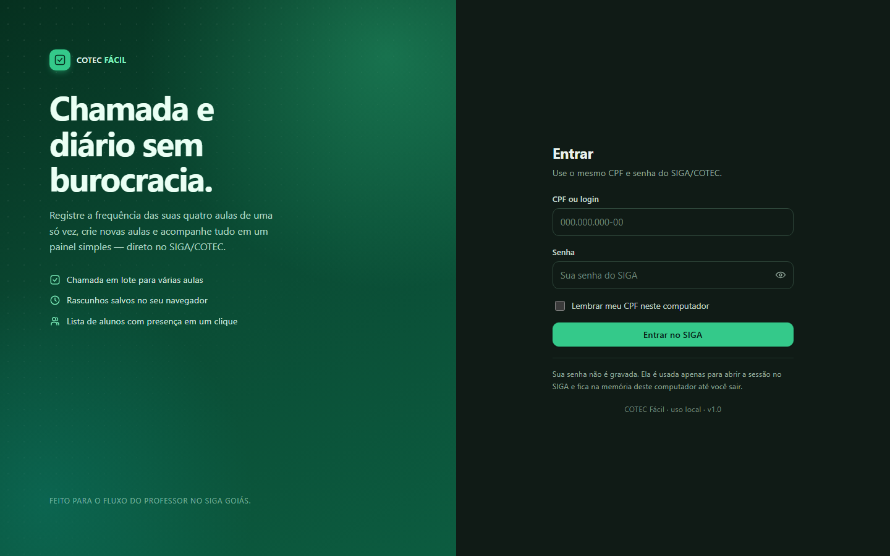
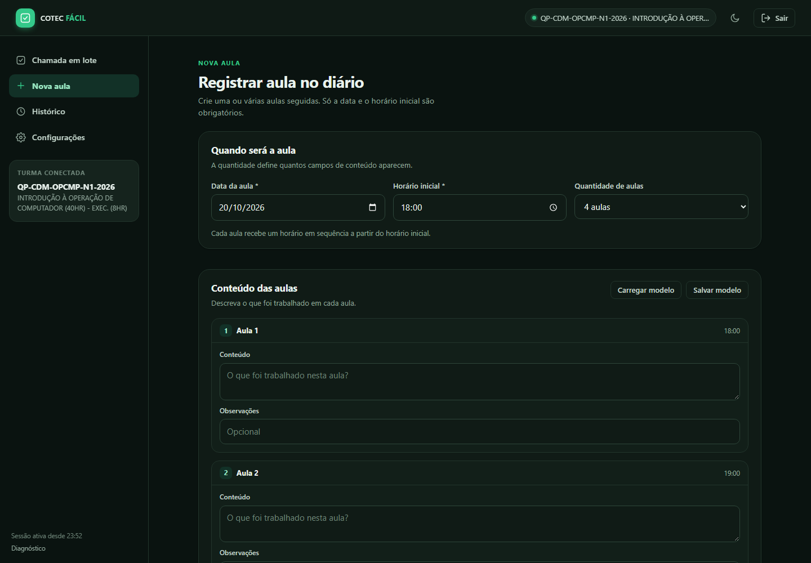

# COTEC Fácil

Painel local para registrar a frequência e criar aulas no diário do **SIGA/COTEC** (Goiás) com menos cliques do que o site original.

O foco é o fluxo do professor que dá várias aulas seguidas no mesmo dia: escolher as aulas, marcar a chamada uma vez e enviar para todas de uma vez.



## O que ele faz

- **Login com a sua conta do SIGA** (CPF/login e senha). A senha não é gravada.
- **Seletor de turma e módulo/componente**: escolha a escola, a turma e o módulo liberado no SIGA. Quando um módulo fecha e outro é liberado, ele aparece na lista.
- **Chamada em lote**: escolhe o dia, marca 1–8 aulas e envia a mesma frequência para todas.
- **Aulas sem chamada em amarelo**: o painel confere o diário e destaca as aulas que ainda não têm nenhuma frequência lançada.
- **Lista de alunos** com presença/ausência em um clique, busca por nome e atalhos “todos presentes”, “todos ausentes” e “inverter”.
- **Presença em bloco**: marque os alunos com checkbox e aplique **Presente** ou **Ausente** de uma vez — ideal para lançar todos como ausentes e depois marcar só quem veio.
- **Rascunho automático** no navegador: se fechar a aba, a seleção e as marcações voltam ao reabrir.
- **Conferência no SIGA**: depois de enviar, o painel reabre cada aula e confere aluno por aluno, mostrando divergências.
- **Nova aula**: cria uma ou várias aulas de uma vez, com conteúdo e observações por aula e plano de aula opcional.
- **Modelos de plano de aula** salvos no navegador.
- **Histórico local** dos envios, com exportação em JSON.
- **Tema claro/escuro** e preferências locais.



## Requisitos

- Windows (o atalho é um `.bat`; em outros sistemas use os comandos manuais).
- [Node.js](https://nodejs.org) 20 ou superior.
- Internet para acessar `siga.cotec.go.gov.br`.

## Como abrir

1. Dê um duplo clique em **`iniciar.bat`**.
2. Na primeira vez ele instala as dependências sozinho.
3. O navegador abre em `http://localhost:3000`.
4. Entre com o **mesmo CPF/login e senha do SIGA**.

Para encerrar, feche a janela preta do servidor (ou pressione `Ctrl+C`).

### Manualmente

```powershell
cd C:\caminho\cotec
npm install
npm start
```

Depois abra `http://localhost:3000`.

## Como escolher a turma e o módulo

1. Ao entrar, o painel abre a primeira turma/componente liberada para o seu usuário.
2. Clique em **Trocar turma/módulo** (no topo ou no cartão da turma).
3. Escolha a **escola**, a **turma** e o **módulo/componente**. Ao trocar a turma, o painel atualiza a lista de módulos liberados no SIGA.
4. Clique em **Abrir diário**. A escolha vale para a chamada, a nova aula e o histórico desta sessão.

> O SIGA libera os módulos conforme o calendário do curso. Quando um módulo fecha, o próximo aparece automaticamente na lista do seletor.

## Como usar a chamada em lote

1. Abra **Chamada em lote**. A data de hoje já vem selecionada; se não houver aula hoje, o painel abre no dia mais próximo com aula.
2. As aulas **em amarelo** ainda não têm frequência lançada no SIGA. Marque as aulas do dia (ou use **Selecionar todas**).
3. Clique em **Carregar alunos**.
4. Ajuste a chamada:
   - **Todos ausentes** para começar do zero e depois marcar só quem veio;
   - marque os presentes com **checkbox** e clique em **Marcar presente** para aplicar de uma vez;
   - ou marque os ausentes e clique em **Marcar ausente**;
   - use **Selecionar todos** para pegar todos os alunos visíveis na busca;
   - **Limpar seleção** desfaz a seleção sem mudar as marcações;
   - a busca por nome ajuda a achar um aluno rapidamente.
5. Clique em **Revisar e enviar** e confira o resumo (aulas, presentes, ausentes e nomes dos ausentes).
6. Confirme. O painel envia aula por aula e mostra o resultado de cada uma.

> A mesma chamada é aplicada a **todas as aulas selecionadas**. É exatamente o caso de quem dá 4 aulas seguidas para a mesma turma.

### Status que já estavam no SIGA

Ao carregar os alunos, o painel importa o status atual de cada um naquela aula. Se houver alunos já marcados como ausentes, aparece um aviso em amarelo com a quantidade. Use **Todos presentes** ou **Todos ausentes** se quiser recomeçar a chamada do zero; depois use os checkboxes para corrigir só quem precisar.

Os status do SIGA também são usados para detectar alterações: o contador mostra quantos alunos estão diferentes do que estava gravado.

## Como criar uma nova aula

1. Abra **Nova aula**.
2. Informe **data**, **horário inicial** e **quantidade de aulas** (1–8).
3. Preencha o conteúdo de cada aula; as observações são opcionais.
4. Se quiser, abra **Plano de aula (opcional)** e preencha objetivo, metodologia, recursos, bibliografia e avaliação.
5. Clique em **Registrar aula no SIGA**.

O painel calcula os horários seguintes a partir da duração da aula (normalmente 60 minutos) e envia no mesmo formato do formulário original do SIGA. Depois de criar, use **Ir para a chamada** para já marcar a frequência dessas aulas.

Os campos do plano podem ser salvos como **modelo** e reutilizados em outras aulas.

## Histórico e rascunhos

- **Histórico**: resumo de cada envio (data, aulas, presentes, ausentes, mensagens e divergências). Fica só no seu navegador e pode ser exportado em JSON.
- **Rascunhos**: um por data. São salvos automaticamente ao selecionar aulas ou marcar alunos. Ao enviar com sucesso, o rascunho daquela data é removido.
- **Configurações**: comportamento padrão, mostrar CPF, horário/quantidade padrão de novas aulas, tema e limpeza dos dados locais.

## Segurança e privacidade

- O painel roda **apenas em `127.0.0.1`** (este computador); não fica exposto na rede.
- A senha do SIGA é usada somente para autenticar e **não é gravada em disco**.
- Os cookies de sessão do SIGA ficam **na memória do processo Node** e são descartados quando o servidor é fechado.
- O navegador guarda apenas um token local de sessão (`sessionStorage`), que some ao fechar a aba, e os dados de rascunho/histórico/preferências (`localStorage`).
- A sessão local expira após **8 horas sem uso**; o SIGA também pode encerrar a sessão antes disso.
- Não há telemetria, anúncios ou envio de dados para terceiros.

## Limitações conhecidas

- O login abre automaticamente a **primeira turma/componente** disponível; use **Trocar turma/módulo** para escolher outra. A lista de módulos depende do que o SIGA libera para o seu usuário.
- A conferência de aulas sem chamada abre a grade de cada aula do dia. Em dias com muitas aulas, isso pode levar alguns segundos.
- A lista de alunos é carregada a partir da **primeira aula selecionada**. Se outra aula tiver alunos diferentes, o envio avisa no resultado (“aluno não encontrado nesta aula”) em vez de marcar errado.
- O painel não preenche justificativas de falta; use o SIGA para isso.
- A conferência depende do SIGA atualizar a grade imediatamente. Se o SIGA estiver lento, pode aparecer divergência; confira no site antes de repetir.
- Alterações no site do SIGA (ScriptCase) podem exigir ajustes no arquivo `src/cotec.js`.

## Problemas comuns

| Problema | O que fazer |
| --- | --- |
| “Sessão encerrada. Entre novamente.” | Normal após 8h ou quando o SIGA expira. Entre de novo; os rascunhos continuam salvos. |
| “Não foi possível falar com o servidor local.” | A janela do servidor foi fechada. Rode `iniciar.bat` novamente. |
| A porta 3000 está em uso | Feche o outro programa ou rode `set PORT=3001 && npm start` e abra `http://localhost:3001`. |
| “Usuário ou senha inválidos” | Confira o CPF e a senha no site do SIGA. O painel usa a mesma autenticação. |
| “O SIGA não recarregou o diário.” | O painel tenta reabrir a turma automaticamente. Se persistir, use **Trocar turma/módulo** e abra o diário de novo. Isso não encerra a sua sessão. |
| Login retorna outra mensagem | Se a resposta do SIGA for inesperada, o painel salva a página recebida em `%TEMP%\cotec-login-debug.html` para diagnóstico. |
| O SIGA demora e dá timeout | O limite é de 45 segundos por requisição; tente novamente. |

## Estrutura do projeto

```
cotec/
├─ iniciar.bat          atalho para Windows
├─ server.js            servidor Express e API local
├─ src/cotec.js         cliente do SIGA, parsers e fluxo de chamada/nova aula
├─ public/
│  ├─ index.html        telas do painel
│  ├─ css/styles.css    estilos e temas
│  └─ js/app.js         lógica da interface
├─ docs/                capturas de tela
└─ package.json
```

### API local (resumo)

| Rota | Função |
| --- | --- |
| `POST /api/login` | autentica no SIGA e cria a sessão local |
| `GET /api/status` | perfil, seleção e diário em cache |
| `GET /api/diario` | recarrega o diário do SIGA |
| `POST /api/opcoes` | carrega turmas/componentes de uma escola ou turma |
| `POST /api/selecionar` | abre o diário da turma/módulo escolhido |
| `POST /api/aulas/status` | confere quais aulas do dia já têm chamada |
| `POST /api/frequencia/abrir` | abre a grade de frequência de uma aula |
| `POST /api/frequencia/aplicar` | registra presenças/faltas e confere |
| `GET/POST /api/nova-aula` | formulário e criação de aula |
| `POST /api/logout` | encerra a sessão local |
| `GET /api/diagnostico` | últimas requisições ao SIGA |

## Observações sobre os testes

Os parsers e o fluxo de tela foram validados com páginas reais do SIGA (somente leitura) e com simulações dos endpoints. O login com senha real precisa ser feito por você, porque o painel não armazena nem usa credenciais fixas. Nenhuma chamada de aluno foi alterada nos testes automatizados.

Durante o desenvolvimento, uma marcação de teste **sem efeito** (aluno já presente recebendo “presente”) foi usada uma única vez para validar o formato do envio ao SIGA.
